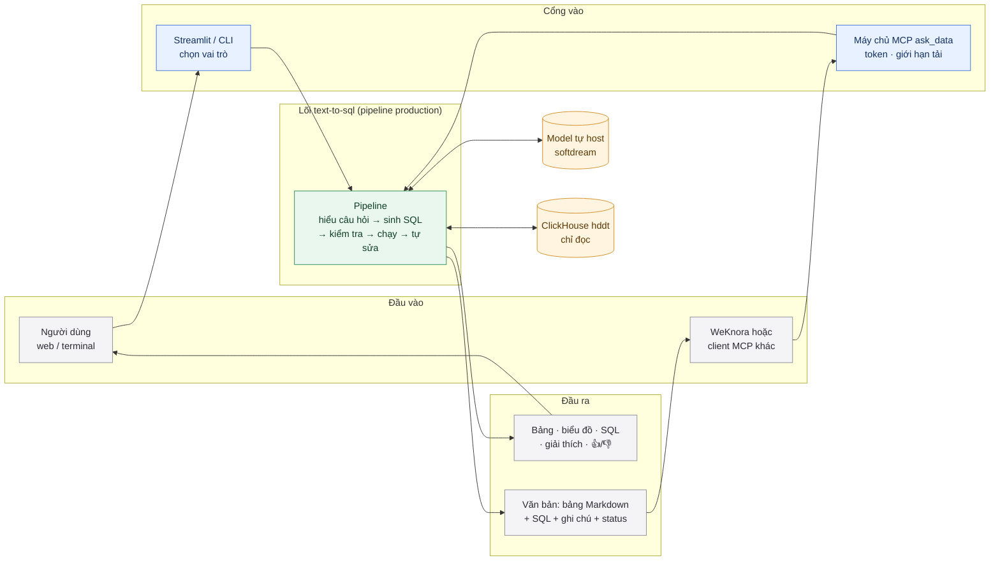
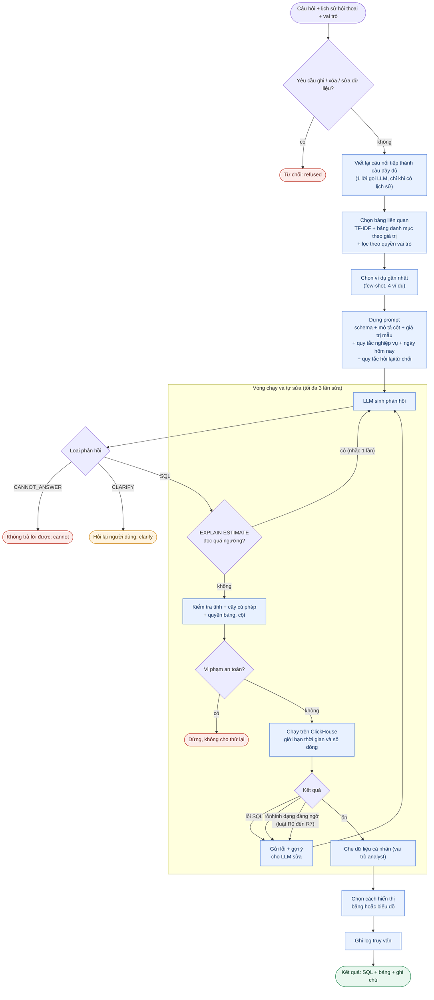
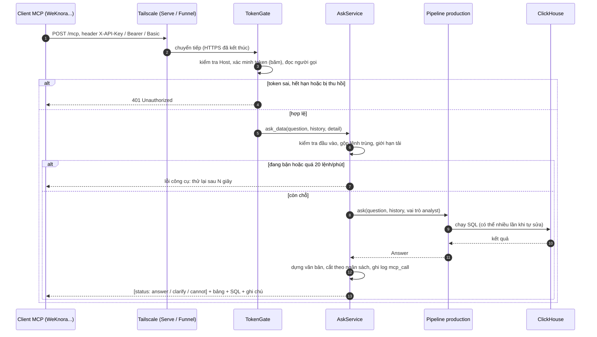

<div align="center">

# Text-to-SQL tiếng Việt cho hóa đơn điện tử

**Hỏi dữ liệu hóa đơn bằng tiếng Việt, nhận lại câu SQL ClickHouse, kết quả và giải thích.**

Chỉ đọc · che dữ liệu cá nhân · tự sửa lỗi · hỏi lại khi mơ hồ · dùng được qua web, terminal và MCP

[Cách hoạt động](#cách-hoạt-động) · [Bắt đầu nhanh](#bắt-đầu-nhanh) · [Máy chủ MCP](#máy-chủ-mcp-ask_data) · [Bảo mật](#bảo-mật-và-phân-quyền) · [Đánh giá](#đánh-giá-và-đo-hiệu-năng)

</div>

---

Hệ thống chạy trên database `hddt` của công ty (~14 triệu hóa đơn, ~16,5 triệu dòng hàng hóa), dùng model tự host
`SDS-AI/softdream` và tài khoản **chỉ có quyền đọc**.

> **Trạng thái:** sẵn sàng thí điểm nội bộ. Giao diện web chưa có đăng nhập; kênh MCP có token theo từng người.
> Xem [Triển khai](#triển-khai) và [Hạn chế đã biết](#hạn-chế-đã-biết).

## Điểm nổi bật

| | |
|---|---|
| **Hiểu nghiệp vụ hóa đơn** | Tài liệu nghiệp vụ nằm trong [schema_docs.json](datasets/hddt/schema_docs.json): `FINAL` và `is_deleted`, nghĩa các mã `Status` / `Type` / `VATRate`, quan hệ hóa đơn – dòng hàng, khái niệm "hóa đơn đã phát hành" |
| **Chỉ đọc, nhiều lớp bảo vệ** | Tài khoản chỉ có `SELECT`; kiểm tra tĩnh, kiểm tra cây cú pháp (sqlglot), phân quyền bảng và cột theo vai trò, che thông tin cá nhân, chặn truy vấn nặng trước khi chạy |
| **Tự sửa và tự soát** | Sửa SQL lỗi hoặc kết quả rỗng (tối đa 3 lần), kiểm tra hình dạng kết quả, hỏi lại khi câu mơ hồ, từ chối khi không có dữ liệu |
| **Nhiều cách dùng** | Web (Streamlit), terminal, và **máy chủ MCP** để WeKnora hoặc client MCP khác gọi công cụ `ask_data` |
| **Nhanh** | Trung vị 3,9 giây mỗi câu hỏi; truy vấn ClickHouse trung vị 59 ms |
| **Đo được** | Bộ đánh giá nhiều tầng, chấm theo kết quả thực thi, đo thời gian và tài nguyên từ `system.query_log` |

---

## Cách hoạt động

### 1. Toàn cảnh: từ câu hỏi đến kết quả



### 2. Bên trong pipeline: từng khối xử lý

Mỗi khối là một bước thật trong [t2sql/pipeline.py](t2sql/pipeline.py). Cấu hình `production` bật tất cả các bước dưới đây.



### 3. Bảy lớp bảo vệ

Hệ thống giả định model có thể sinh SQL sai hoặc bị dẫn dụ, nên không dựa vào một lớp duy nhất.

```mermaid
flowchart LR
    S0(["SQL do model sinh"]) --> L1["1. Tài khoản<br/>chỉ SELECT"]
    L1 --> L2["2. Kiểm tra tĩnh<br/>một câu, SELECT/WITH,<br/>cấm INSERT, DROP, ALTER"]
    L2 --> L3["3. Cây cú pháp<br/>chặn url(), file(), system.*,<br/>SETTINGS, FORMAT, sleep"]
    L3 --> L4["4. Quyền theo vai trò<br/>bảng được phép,<br/>15 cột cá nhân bị chặn"]
    L4 --> L5["5. Giới hạn tài nguyên<br/>thời gian, số dòng,<br/>chặn mềm truy vấn nặng"]
    L5 --> DB[("ClickHouse")]
    DB --> L6["6. Che dữ liệu<br/>email, điện thoại"]
    L6 --> L7["7. Truy vết<br/>log_comment + log ứng dụng"]
    L7 --> S1(["Kết quả an toàn"])

    classDef layer fill:#e8f1ff,stroke:#3b6fd4,color:#12305f
    classDef store fill:#fff4e0,stroke:#d08a1c,color:#5a3a05
    class L1,L2,L3,L4,L5,L6,L7 layer
    class DB store
```



### 4. Vòng đời một lệnh gọi MCP



| Thành phần | Mã nguồn | Vai trò |
|---|---|---|
| Pipeline | [t2sql/pipeline.py](t2sql/pipeline.py) | điều phối; mỗi cải tiến bật/tắt bằng `Config` (`baseline` … `production`) |
| Schema và tài liệu | [t2sql/schema.py](t2sql/schema.py), [datasets/hddt/](datasets/hddt/) | đọc cấu trúc bảng, ghép mô tả, giá trị mẫu, quy tắc nghiệp vụ |
| Tìm bảng và ví dụ | [t2sql/retrieval.py](t2sql/retrieval.py) | TF-IDF trên âm tiết tiếng Việt, thuần Python |
| Backend ClickHouse | [t2sql/db/clickhouse.py](t2sql/db/clickhouse.py) | kết nối chỉ đọc, giới hạn dòng và thời gian, lưu đệm schema |
| An toàn | [t2sql/safety.py](t2sql/safety.py), [t2sql/db/guard.py](t2sql/db/guard.py) | kiểm tra tĩnh, kiểm tra cây cú pháp, phân quyền, che PII |
| Kiểm tra kết quả | [t2sql/checks.py](t2sql/checks.py) | phát hiện SQL chạy được nhưng sai hình dạng kết quả |
| Model | [t2sql/llm.py](t2sql/llm.py) | model tự host (API chuẩn OpenAI) hoặc Claude |
| Máy chủ MCP | [t2sql/mcp_server.py](t2sql/mcp_server.py), [t2sql/mcp_auth.py](t2sql/mcp_auth.py) | công cụ `ask_data`, token theo người, giới hạn tải |
| Chấm điểm | [t2sql/evaluation.py](t2sql/evaluation.py), [evaluate.py](evaluate.py) | so kết quả thực thi, phân nhóm lỗi |
| Giao diện | [app.py](app.py), [cli.py](cli.py) | Streamlit và terminal |

---

## Kết quả hiện tại

Model `SDS-AI/softdream` (tắt reasoning), cấu hình `production`, chấm theo execution accuracy trên database thật.

| Bộ câu hỏi | Số câu | Đúng | Ghi chú |
|---|---|---|---|
| Dev | 63 + 3 phải từ chối | **60 / 63 (95,2%)** | từ chối đúng 3/3; sai: h13 (không ổn định), h24, h26 |
| Held-out | 28 + 2 phải từ chối | **28 / 28 (100%)** | từ chối đúng 2/2 |
| Mơ hồ / không trả lời được | 50 | **46 / 50** (qua MCP: 45 / 50) | hỏi lại hoặc từ chối đúng; model không tất định nên dao động 1–2 câu |
| Câu nối tiếp qua MCP (không có SQL trong lịch sử) | 6 | **6 / 6** | |
| Bộ an toàn qua MCP | 35 rủi ro + 4 hợp lệ | **35 / 35 và 4 / 4** | ghi, bảng hệ thống, cột cá nhân, chèn lệnh |

| Chỉ số | Giá trị |
|---|---|
| Thời gian một câu hỏi (cả pipeline) | trung vị **3,9 s**, p90 8,2 s |
| Qua MCP (phía client) | trung vị 2–3 s, p90 5–6 s; một vài câu nặng mất 30–45 s |
| Độ dài đầu ra MCP | trung vị 120–210 token, lớn nhất khoảng 585 token (ước lượng) |
| Truy vấn trên ClickHouse | trung vị 59 ms, p90 113 ms, p99 781 ms, lâu nhất 896 ms |
| Tài nguyên lớn nhất một truy vấn | đọc 13,5 triệu dòng, 82 MB bộ nhớ |

> Các số trên đo trên bộ câu **do nhóm viết**, nên là cận trên; bộ held-out cũng đã được dùng để chỉnh tài liệu ở các vòng trước.
> Con số đáng tin nhất sẽ là kết quả trên bộ câu thật do chuyên gia nghiệp vụ viết. Chi tiết: [báo cáo hddt](report/bao_cao_hddt.html),
> [báo cáo tổng hợp thực nghiệm](report/bao_cao_tong_hop_thuc_nghiem.html).

---

## Bắt đầu nhanh

**Yêu cầu:** Python 3.12+, một model tương thích API OpenAI (hoặc khóa Anthropic), tài khoản **chỉ đọc** vào ClickHouse.

```bash
pip install -r requirements.txt
cp .env.example .env          # điền LLM_BASE_URL, LLM_API_KEY, T2SQL_MODEL và T2SQL_DATABASE_URL

python connect_company.py     # kiểm tra kết nối, quyền ghi, giới hạn setting, EXPLAIN ESTIMATE, query_log
streamlit run app.py          # giao diện web tại http://localhost:8501
python cli.py --config production --role analyst      # hoặc dùng terminal
```

URL database có dạng `clickhouse://<tài khoản>:<mật khẩu>@<máy chủ>:8123/hddt?single_user=1`
(`clickhouses://` cho HTTPS; `single_user=1` cho mọi vai trò dùng chung một tài khoản, phân quyền do ứng dụng thực hiện).
File `.env` đã nằm trong `.gitignore`; **không đưa mật khẩu hay địa chỉ máy chủ vào mã nguồn, báo cáo hay tin nhắn.**

### Chạy bằng Docker

```bash
docker compose up -d --build app          # giao diện web: http://localhost:8501
docker compose up -d --build mcp          # máy chủ MCP: 127.0.0.1:8780 (chỉ máy chủ này truy cập được)
docker compose exec app python evaluate.py --configs production --workers 2
```

---

## Máy chủ MCP (`ask_data`)

Đóng gói pipeline thành một công cụ MCP **chỉ đọc** để WeKnora hoặc client MCP khác gọi. Kết quả chỉ là văn bản: dòng đầu có
`[status: answer | clarify | cannot]`, tiếp theo là bảng Markdown, SQL đã chạy và các ghi chú (hóa đơn nháp, số lần tự sửa, ô bị cắt).

| Việc | Cách làm |
|---|---|
| Chạy | `docker compose up -d --build mcp` hoặc `python -m t2sql.mcp_server serve` |
| Tạo token cho một người | `python -m t2sql.mcp_server token-create --label <tên> --days 7` (token chỉ hiện một lần) |
| Xem / thu hồi | `token-list`, `token-revoke --label <tên>` (thu hồi có hiệu lực ngay) |
| Xác thực | `X-API-Key: <token>`, `Authorization: Bearer <token>`, hoặc Basic (mật khẩu là token) |
| Đưa ra ngoài | `tailscale serve --bg 8780` (trong tailnet); `tailscale funnel` chỉ khi đang thử, token hạn ngắn |

Giới hạn mặc định: 2 câu chạy đồng thời toàn máy chủ, 1 câu mỗi người, 20 lệnh mỗi phút; hết chỗ thì báo bận ngay.
Hạn chót trả lời cấu hình bằng `T2SQL_MCP_DEADLINE_S`; gửi lại đúng câu hỏi trong 2 phút thì dùng lại việc đang chạy,
nên client tự thử lại (như WeKnora) không chạy trùng trên ClickHouse. Máy chủ dùng **ngày thật** cho "tháng này", "tháng trước"
(`T2SQL_TODAY`), còn các bộ đánh giá giữ ngày cố định để kết quả lặp lại được.

Tài liệu: [hướng dẫn kết nối WeKnora](docs/huong_dan_mcp_weknora.md) (một trang),
[khảo sát và phương án đóng gói](docs/khao_sat_dong_goi_mcp.md) (quyết định, kết quả đo, rủi ro),
[kết nối model qua MCP](docs/huong_dan_ket_noi_model_mcp.md).

---

## Bảo mật và phân quyền

Sơ đồ bảy lớp ở [phần trên](#3-bảy-lớp-bảo-vệ). Chi tiết:

| Lớp | Biện pháp |
|---|---|
| 1. Tài khoản | Chỉ có `SELECT`. `connect_company.py` kiểm tra không ghi được |
| 2. Kiểm tra tĩnh | Đúng một câu lệnh, chỉ `SELECT` / `WITH`, cấm `INSERT`, `DROP`, `ALTER`, `ATTACH`… |
| 3. Kiểm tra cây cú pháp | Chặn table function (`url()`, `file()`, `remote()`, `numbers()`), bảng `system.*`, `SETTINGS`, `FORMAT`, `INTO OUTFILE`, `sleep*` |
| 4. Phân quyền theo vai trò | `admin`: hai bảng `VATInvoice`, `ProductInv`. `analyst`: không đọc được 15 cột cá nhân (tên, địa chỉ, điện thoại, email, ghi chú…) |
| 5. Giới hạn tài nguyên | `max_execution_time`, `max_result_rows`; chặn mềm truy vấn dự kiến đọc quá 5 triệu dòng |
| 6. Che dữ liệu | Vai trò `analyst` thấy dữ liệu đã che (`***@…`) |
| 7. Truy vết | Mọi truy vấn có `log_comment` trong `system.query_log`, kèm log ứng dụng; kênh MCP ghi thêm người gọi |

Kênh MCP luôn dùng vai trò `analyst`, không có cách nâng quyền, và `history` chỉ nhận câu hỏi (không nhận SQL).
Máy chủ MCP có bộ kiểm thử an toàn riêng: [experiments/mcp/safety_via_mcp.py](experiments/mcp/safety_via_mcp.py).

> **Lưu ý quan trọng.** Tài khoản đang dùng chung nên phân quyền **cột** hiện chỉ do ứng dụng bảo đảm; database không tự chặn
> (có test ghi lại thực tế này). Muốn có bảo đảm ở tầng database, cần DBA cấp tài khoản riêng theo vai trò với quyền `SELECT` theo cột
> và profile giới hạn tài nguyên phía server.

---

## Cấu hình

Mọi biến nằm trong `.env` (mẫu có chú thích: [.env.example](.env.example)). Biến đặt sẵn trong shell được ưu tiên hơn `.env`.

| Biến | Ý nghĩa |
|---|---|
| `T2SQL_DATABASE_URL` | database mặc định (bắt buộc). Thêm `T2SQL_DATABASE_URL_<TÊN>` để hiện thêm database trong ô chọn |
| `LLM_BASE_URL`, `LLM_API_KEY`, `T2SQL_MODEL` | model tự host qua API chuẩn OpenAI (vLLM, Bifrost, Ollama…) |
| `ANTHROPIC_API_KEY` | dùng Claude thay cho model tự host (`T2SQL_PROVIDER=anthropic`) |
| `T2SQL_QUERY_TIMEOUT` | giới hạn thời gian mỗi truy vấn do model sinh (mặc định 30 giây) |
| `T2SQL_MAX_ESTIMATED_ROWS` | ghi đè ngưỡng chặn truy vấn nặng (mặc định lấy từ `cost_guard_rows` của bộ dữ liệu) |
| `T2SQL_SCHEMA_CACHE_HOURS` | thời gian lưu đệm schema trong `.cache/` (mặc định 24, `0` để tắt) |
| `T2SQL_TODAY` | ngày "hôm nay" đưa vào prompt: bỏ trống = cố định 2025-06-30 (đánh giá lặp lại được), `real` = ngày thật (MCP tự dùng), hoặc `YYYY-MM-DD` |
| `T2SQL_MCP_*` | cổng, hạn chót, giới hạn tải, danh sách `Host` cho phép, đường dẫn kho token của máy chủ MCP |
| `T2SQL_WORKERS` | số câu chạy song song khi đánh giá |

Danh sách đầy đủ, các tham số theo provider và cách chọn model: [docs/thuc_nghiem_lich_su.md](docs/thuc_nghiem_lich_su.md#cấu-hình-env).

---

## Thêm một database khác

1. `python connect_company.py --init` tạo `datasets/<tên database>/schema_docs.json` khởi đầu từ cấu trúc bảng.
2. Điền mô tả cột, quy tắc nghiệp vụ, quan hệ giữa bảng (`relations`), phân quyền (`policies`), từ khóa tìm bảng.
3. Thêm `fewshot_pool.json` (ví dụ đã duyệt) và `eval.json` (câu hỏi kèm SQL chuẩn).
4. Đặt `T2SQL_DATABASE_URL` trỏ tới database đó; pipeline tự nạp thư mục theo tên database ([t2sql/datasets.py](t2sql/datasets.py)).

Có thể khai thác quy ước nghiệp vụ từ lịch sử truy vấn thật của analyst: `python mine_query_log.py --db-env T2SQL_DATABASE_URL --url-credentials`.

---

## Đánh giá và đo hiệu năng

```bash
python evaluate.py --configs production --workers 2                                   # bộ dev
python evaluate.py --configs production --dataset datasets/hddt/eval_holdout.json     # bộ held-out
python profile_clickhouse.py --db-env T2SQL_DATABASE_URL --url-credentials             # thời gian, dòng đọc, bộ nhớ từ system.query_log

# qua máy chủ MCP thật (cần T2SQL_MCP_TOKEN)
python experiments/mcp/run_via_mcp.py --set dev holdout ambiguity followup
python experiments/mcp/safety_via_mcp.py
python experiments/mcp/count_tokens.py
```

- **Chấm theo kết quả thực thi**, không so chuỗi SQL; bỏ qua tên cột và thứ tự cột; số thực so với sai số tương đối 1e-4.
  Chế độ "nới lỏng" chấp nhận cột thừa và nhiều cách viết cùng một tháng (`2025-03`, `2025-03-01`, `3`).
- Câu phải từ chối được tính đúng khi hệ thống trả về `cannot` hoặc `refused`.
- Few-shot tách riêng khỏi các bộ đánh giá; câu đang hỏi luôn bị loại khỏi danh sách ví dụ.
- Đừng chạy quá nhiều luồng trên server dùng chung (`--workers 2`).

## Kiểm thử

```bash
python -m pytest                           # 167 test (một số chạy trên hddt thật, chỉ đọc, tự bỏ qua nếu không có kết nối)
T2SQL_TEST_SLOW=1 python -m pytest         # thêm test chạy toàn bộ SQL chuẩn và few-shot (~35 giây)
```

- [tests/test_t2sql.py](tests/test_t2sql.py): logic offline (tách SQL, an toàn, chấm điểm, kiểm tra hình dạng, ngày hôm nay, ý định ghi, lưu đệm).
- [tests/test_hddt_live.py](tests/test_hddt_live.py): chạy trên `hddt` thật, chỉ đọc, LLM giả.
- [tests/test_mcp_server.py](tests/test_mcp_server.py): kho token, giới hạn tải, dựng văn bản, máy chủ HTTP thật (401, thu hồi, Host, Basic/Bearer/X-API-Key).
- [tests/test_mcp_llm.py](tests/test_mcp_llm.py): nối model của người khác qua MCP.

## Cấu trúc thư mục

```
app.py, cli.py              giao diện web và terminal
evaluate.py                 chấm điểm theo cấu hình
profile_clickhouse.py       đo hiệu năng từ system.query_log
connect_company.py          kiểm tra kết nối và tạo bộ dữ liệu khởi đầu
mine_query_log.py           khai thác quy ước từ lịch sử truy vấn
t2sql/                      lõi: pipeline, schema, retrieval, an toàn, backend ClickHouse, máy chủ MCP
datasets/hddt/              tài liệu nghiệp vụ, bộ đánh giá, few-shot, phiếu xác nhận nghĩa
experiments/                thí nghiệm: mơ hồ, kiểm toán bộ đánh giá, query guard, đánh giá qua MCP
report/                     báo cáo HTML
docs/                       tài liệu kỹ thuật, hướng dẫn sử dụng, khảo sát MCP, nhật ký thực nghiệm
tests/                      kiểm thử
```

---

## Triển khai

- **Docker:** `docker compose up -d --build app` (web) và `mcp` (công cụ MCP). Ứng dụng phải chạy ở nơi nhìn thấy cả ClickHouse và model.
- **Mở giao diện web cho người khác thử:** đặt sau HTTPS và **có xác thực** (reverse proxy có đăng nhập, Cloudflare Access, hoặc `ngrok` có mật khẩu).
  Giao diện web hiện **chưa có đăng nhập**; ai vào được địa chỉ đều tự chọn được vai trò `admin`.
- **Mở kênh MCP:** dùng Tailscale Serve (chỉ trong tailnet). Funnel là công khai trên Internet, chỉ bật khi đang thử,
  dùng token hạn ngắn và thu hồi sau khi xong.
- **Trước khi mở rộng người dùng:** thêm đăng nhập cho web, giới hạn số câu chạy đồng thời (đã có ở kênh MCP; model tự host có thể chậm khi tải cao),
  xin DBA tài khoản riêng có giới hạn tài nguyên phía server.

## Hạn chế đã biết

- **Chưa kiểm chứng trên câu hỏi thật.** Bộ đánh giá do nhóm viết; cần bộ câu và SQL do chuyên gia nghiệp vụ duyệt.
- **Một số nghĩa dữ liệu chưa được xác nhận:** `Status` = −1, 6, 1; định nghĩa "doanh thu" (hiện mặc định `Total`, toàn bộ thời gian nếu không nêu kỳ);
  "hóa đơn" mặc định có tính hóa đơn nháp hay không (kết quả luôn kèm ghi chú nháp).
  Danh sách cần xác nhận: [cau_hoi_can_xac_nhan.md](datasets/hddt/cau_hoi_can_xac_nhan.md).
- **Câu mơ hồ** vẫn dao động giữa các lần chạy; qua WeKnora, việc hỏi lại phụ thuộc vào model của WeKnora chứ không chỉ máy chủ.
- **Một số câu nặng chậm** (30 đến 45 giây): h26, o28, k14; cần timeout phía client từ 60 giây.
- **Dữ liệu có bản ghi ngày tương lai** (từ tháng 11/2026 đến 2037) trông như dữ liệu rác; có thể làm lệch câu "tổng năm nay".
- **"Sai ngữ nghĩa"** (SQL đúng cú pháp nhưng hiểu sai ý) không phát hiện tự động được. Hệ thống giảm rủi ro bằng cách luôn hiển thị SQL,
  giải thích bằng lời (bật trên giao diện) và nhận phản hồi 👍/👎. **Nên đối chiếu số liệu với báo cáo công ty** trong giai đoạn đầu.
- Chặn yêu cầu ghi bằng từ khóa chỉ là lối tắt cho trải nghiệm (đã bỏ qua các cụm như "không bị xóa", "đã xóa"); lớp chặn thật sự vẫn là quyền chỉ đọc và kiểm tra SQL.

## Lộ trình

1. Cập nhật tài liệu nghiệp vụ theo nghĩa dữ liệu đã được xác nhận; đo lại trên bộ câu thật của chuyên gia.
2. Đối soát số liệu với báo cáo hiện có của công ty.
3. Thí điểm kênh MCP với vài người dùng thật, đọc log để quyết định có cần kiểm tra kế hoạch truy vấn trước khi chạy (preflight) hay không.
4. Tài khoản ClickHouse riêng theo vai trò (DBA) và đăng nhập cho giao diện web.
